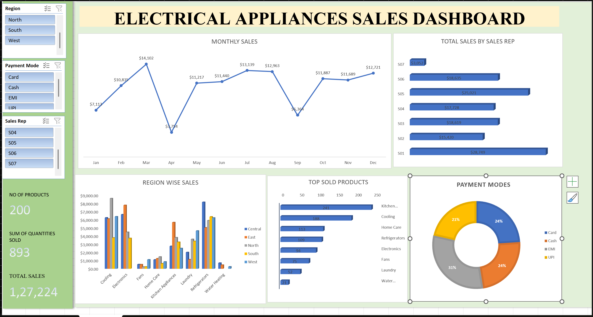
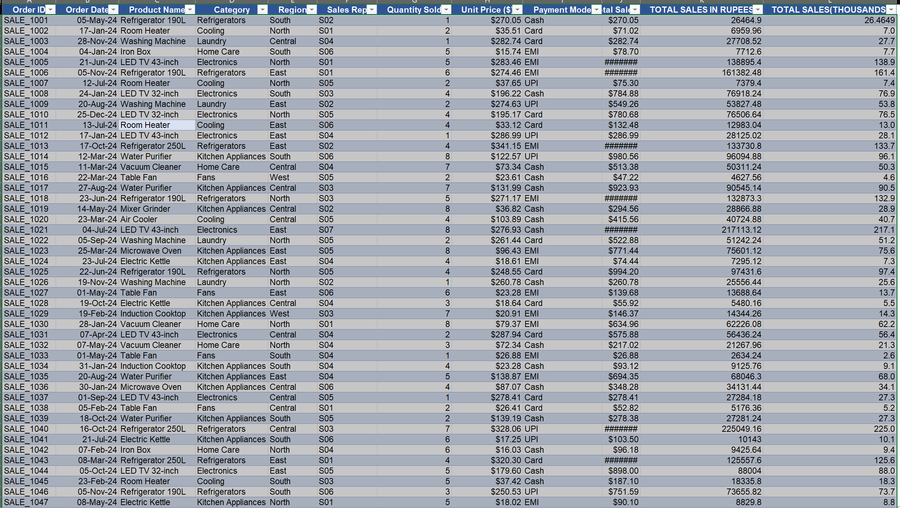

# Electrical-Appliances-Dashboard
### An interactive Excel dashboard project designed to analyze and visualize data using charts, graphs, and key performance indicators (KPIs). This project helps transform raw data into meaningful insights, making it easier to identify trends, monitor performance, and support data-driven decision-making.

## Project Preview

## Project Overview
This project is an Excel dashboard designed to analyze and visualize data in an easy-to-understand format. It presents key information through charts, graphs, and performance indicators. Users can explore data trends, identify patterns, and gain valuable insights to support better decision-making.

## From Data to Dashboard
The project was created using Microsoft Excel by organizing and analyzing data, applying data-cleaning techniques, and creating charts and visualizations. An interactive dashboard was designed to present key insights and trends in a clear and visually appealing way. The final dashboard helps users understand the data and make informed decisions.

## Source Data

## Dashboard Features
- **Data Visualization:** Presents data using charts and graphs.
- **Interactive Dashboard:** Provides a clear and user-friendly view of data.
- **Data Analysis:** Helps identify trends, patterns, and key insights.
- **Performance Tracking:** Displays important metrics and key performance indicators (KPIs).
- **Decision Support:** Helps users understand data and make informed decisions.

## Files Included
| File | Description |
|---|---|
| DASHBOARD.xlsx | Completed Excel dashboard |
| Dashboard.png | Preview of the final dashboard |
| Data.png | Preview of the source data |
| README.md | Project documentation |

## How to Download and Use

1. Download your-dashboard.xlsx.
2. Open the workbook using Microsoft Excel.
3. Navigate to the dashboard worksheet.
4. Use the available filters and slicers to explore the results.

[Download the Excel Dashboard](DASHBOARD.xlsx)

